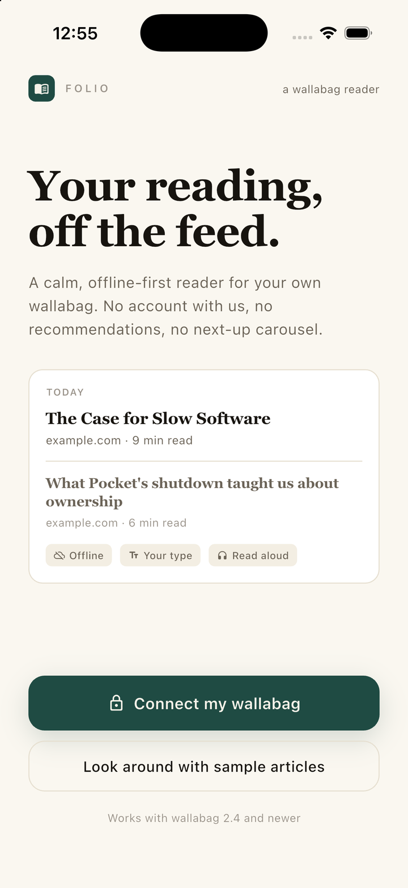
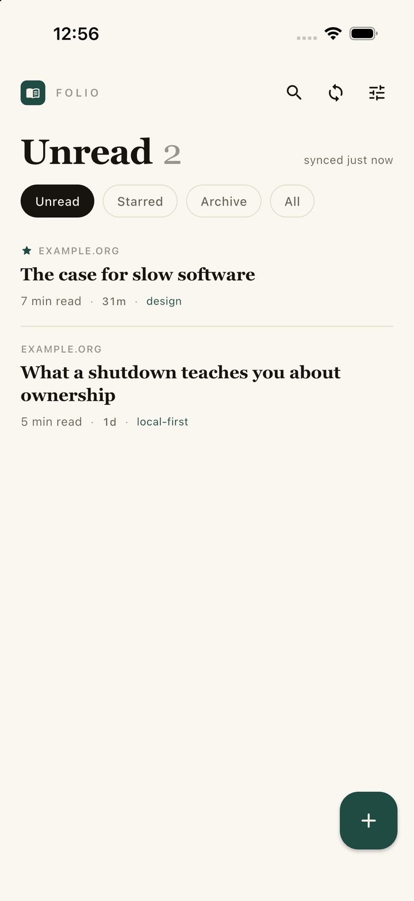
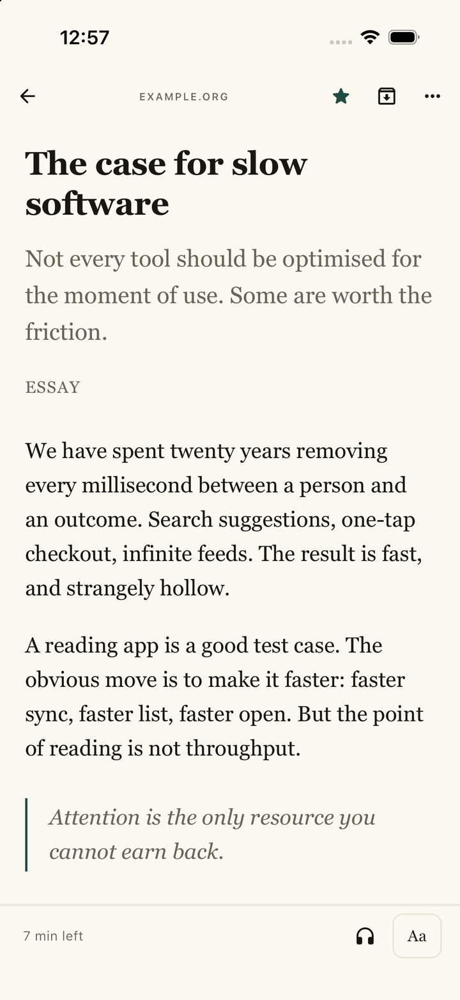
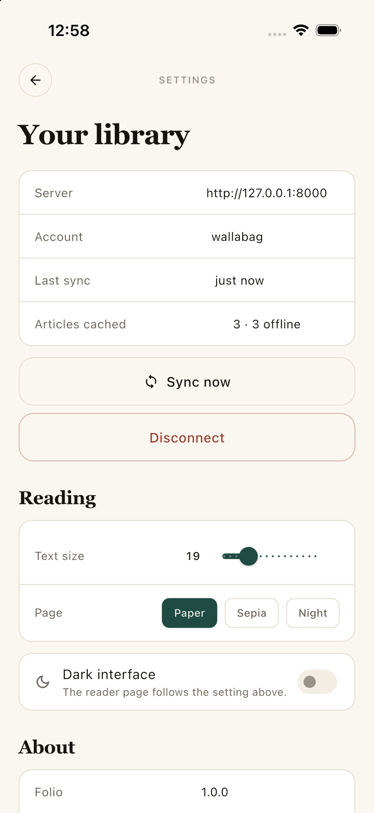

# Folio — a wallabag reader for iOS and Android

**Your reading list, off the feed.** A calm, offline-first Flutter client for
[wallabag](https://wallabag.org), the self-hosted read-later server. No account
with us, no recommendations, no telemetry, no next-up carousel.

[](LICENSE)
[](https://flutter.dev)
[](#install)
[](CONTRIBUTING.md)

<a href="docs/screenshots/welcome.png"></a>
<a href="docs/screenshots/home.png"></a>
<a href="docs/screenshots/reader.png"></a>
<a href="docs/screenshots/settings.png"></a>

## Why this exists

- Pocket shut down, and its export carries links and titles — not the clean
  copies of articles you actually saved.
- Wallabag is the durable alternative, but its clients lag: the official iOS app
  [went closed-source with paid tiers](https://wallabag.org/news/20260327-important-change-ios-app/)
  in 2026, and users routinely call the Android client "basic and outdated"
  ([HN thread](https://news.ycombinator.com/item?id=44597668)).
- A reading list is a decade of attention. It deserves a client that looks like
  a book, not a feed.

Folio is not affiliated with the wallabag project. It speaks the public v2 API.

## What's in it

**Reading**
- Unread, Starred, Archive and Everything, with live counts.
- Swipe to archive; long-press for star / archive / open original / delete.
- Reader typography you control: 15–30 pt, line height, serif or sans,
  Paper / Sepia / Night page.
- Reading position saved per article (percent + scroll offset), restored on open.
- Read aloud with the system TTS voice.
- Links leave the reader for the browser; the article stays put.

**Offline first**
- The list, the content you've opened and every action are local.
- Archive / star / delete are optimistic and queued; the queue replays on the
  next sync, so airplane mode doesn't lose intent.
- A failed sync never blocks the UI: it shows a banner and keeps your cached list.

**Connecting**
- OAuth password grant: server URL + client id/secret + login. The password is
  used once and never stored; only the token is.
- Or paste an existing access token.
- Demo mode with four sample articles, so the app is explorable and reviewable
  before any server exists.
- Plain `http://` is allowed for LAN installs (`NSAllowsArbitraryLoads` on iOS,
  `usesCleartextTraffic` on Android — both intentional).

**Privacy**
- No servers of ours. Nothing to shut down that would take your library with it.
- The only outbound requests are to the wallabag instance you configure.

## Install

**Android** — grab the APK from [Releases](../../releases):

```bash
adb install app-arm64-v8a-release.apk
```

**iOS** — build from source (no App Store listing yet, see [Roadmap](#roadmap)):

```bash
flutter pub get
flutter run -d <device>
```

Requirements: Flutter 3.35+, iOS 16+, Android 8+.

### Connecting

1. Open your wallabag web UI → **Developer** → **Create a client**.
2. In Folio, enter your server URL (e.g. `https://bag.example.com`), the client
   id and secret, and your wallabag username and password.

## Development

```bash
flutter pub get
flutter analyze
flutter run
```

No server handy? A small API double is included:

```bash
python3 tool/mock_wallabag.py                       # :8000, three articles
flutter run --dart-define=MOCK_CONNECT=http://127.0.0.1:8000
```

Debug hooks: `--dart-define=OPEN_ENTRY=101` opens a reader directly,
`--dart-define=OPEN_SETTINGS=true` opens settings. The icon is generated by
`python3 tool/make_icon.py`.

### Testing against a real server

The API double is a convenience, not a contract — it was written by the same
person as the client, so it can only prove the client agrees with itself. Run
the live suite against your own instance:

```bash
docker run -d --name wallabag -p 8080:80 \
  -e SYMFONY__ENV__DATABASE_DRIVER=pdo_sqlite \
  -e POPULATE_DATABASE=true wallabag/wallabag:latest

# create a user and a client (console has no add-user command in 2.6)
docker exec wallabag php bin/console --env=prod fos:user:create \
  valk valk@example.com 'test-pass' --super-admin

WALLABAG_URL=http://127.0.0.1:8080 \
WALLABAG_CLIENT=<client id> WALLABAG_SECRET=<client secret> \
WALLABAG_USER=valk WALLABAG_PASS=test-pass \
flutter test test/live_wallabag_test.dart
```

The suite checks the payload shapes, full-content fetch, and that star/archive
actually change server state (a PATCH that returns 200 but changes nothing is a
failure, not a pass).

### Structure

```
lib/
  wallabag.dart     API client (OAuth, entries, patch, delete) + local-first store
  theme.dart        paper/ink palette, serif scale, light + dark themes
  widgets.dart      buttons, fields, tags, notice bar, empty states
  screens/
    welcome.dart    connect flow (password or token) and demo entry
    home.dart       list, boxes, search, swipe actions, save-a-link sheet
    reader.dart     WebView reader, per-article typography, TTS, progress
    settings.dart   account, sync, reading defaults, about
tool/
  mock_wallabag.py  local API double with sample articles
  make_icon.py      generates the iOS + Android app icon
```

## Roadmap

- [ ] Share extension (iOS) and share intent (Android) — save from any app
- [ ] Paginated archive and starred boxes
- [ ] Server-side search
- [ ] Tag editing and highlights
- [ ] F-Droid submission
- [ ] iOS App Store build

## Known limits

- Share target is not implemented yet; adding a link works from the in-app sheet.
- Search runs over the local cache, not the server's full index.
- The archive box shows the first page fetched (30) plus anything touched
  locally.
- Tag editing and highlights are display-only.
- TTS uses the device voice; no per-article voice selection.
- Tested end to end against **wallabag 2.6.15** (Docker, SQLite) on the iOS
  simulator: OAuth connect, list sync, reader content fetch, star and archive
  round-trips, and the offline queue. `test/live_wallabag_test.dart` re-runs the
  same checks against any instance you point it at.

## Contributing

Bug reports and PRs are welcome — see [CONTRIBUTING.md](CONTRIBUTING.md). If
Folio saves you from a feed, a star helps other wallabag users find it.

## License

[GPL-3.0](LICENSE). The wallabag name and logo belong to the wallabag project.
